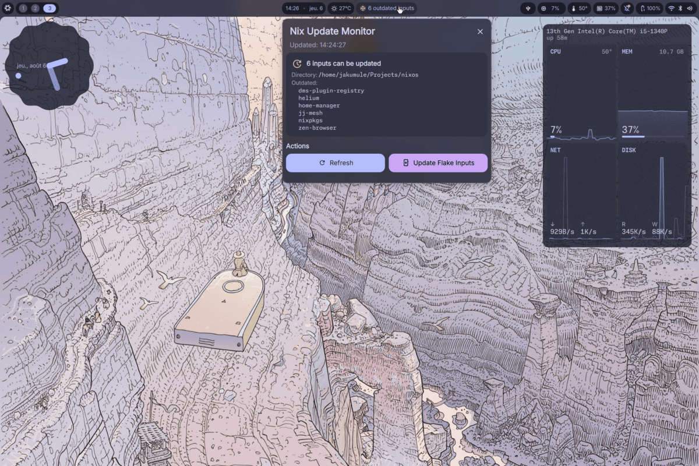

# Nix Update Monitor



A [DankMaterialShell](https://danklinux.com/) plugin for monitoring nixpkgs/flake input updates.

> **Note:** Nix store size, system generation count, and the Rebuild/GC action buttons used to be
> here too. That logic has been stripped out for now (it may come back later) - this is purely an
> update monitor at the moment.

## Features

### Two Monitor Modes
- **Standard mode** - Normal NixOS/channel behavior: compares your local nixpkgs revision against a channel branch (e.g. `nixos-unstable`) via `git ls-remote`
- **Flake mode** - For flake-based configurations: checks `flake.lock` at a configured directory for inputs that have newer revisions available upstream, and lists which inputs are outdated. It also shows which packages updating and rebuilding would change compared with your running system, using [dix](https://github.com/faukah/dix) (see below)

### Flake mode: two separate questions
"Your inputs are up to date" and "your system is up to date" are not the same thing - bumping
`flake.lock` (or editing your config) without rebuilding leaves the inputs current but the
running system stale. Flake mode therefore tracks the pipeline **upstream → flake.lock →
running system**, and shows one package diff across the whole of it:
- **Upstream → flake.lock** - inputs with newer upstream revisions (`check-flake-updates.sh`)
- **flake.lock → System** - whether `/run/current-system` is exactly what the flake (working
  tree, uncommitted edits included) evaluates to (`check-system-sync.sh`). Re-checked
  automatically within ~15 s of a switch. Only applies to `nixosConfigurations` outputs; can be
  turned off with `checkSystem = false`
- **Package diff** - running system → the flake with fully updated inputs, i.e. what
  `nix flake update` + rebuild would change (`diff-flake-update.sh`). Computed even when
  `flake.lock` is already current, so a pending rebuild shows up too

### Bar Widget Display
- Update status - Check icon shows update status for the active mode:
  - Green: Up-to-date (nixpkgs, or all flake inputs)
  - Yellow: Update available (nixpkgs, or one or more flake inputs outdated)
  - Red: Could not fetch version info / could not check flake inputs
- Flake mode: the snowflake is followed by the outdated-input count, and by a rebuild icon
  (→ ⟲) when the running system is behind the flake (red if that check failed)

### Detailed Popout Panel
Click the widget to open a detailed view with:
- Status line - overall state, the flake directory or channel, and when it was last checked
- Standard mode - local vs. remote nixpkgs revision
- Flake mode dashboard:
  - **Pipeline** - upstream → flake.lock → system, each link colored by its state
  - **Inputs** - a chip per outdated input showing how much newer upstream is; hover for the locked → upstream revision
  - **If you update & rebuild** - stat tiles (upgraded / added / removed / downgraded; click one to show only that kind) and a searchable package list grouped into collapsible sections, measured against the running system (labelled with its generation)
- Refresh button (header) - re-run all checks and recompute the package diff

### Configurable Settings
Access via DMS Settings → Plugins → Nix Update Monitor - every setting is editable here,
including commands - see "Configuration" below:
- Enable/disable update checking
- Monitor mode - Standard or Flake
- NixOS channel selection (unstable, 25.11, 25.05, 24.11) - standard mode
- Flake directory and output attribute - flake mode
- Update check interval (300-86400 seconds)
- Revision-check commands

## Installation

This plugin has no Nix module of its own - it's installed and configured entirely through
DankMaterialShell's own plugin system (`programs.dank-material-shell.plugins`), the same
mechanism used for registry plugins like `dockerManager`. **This requires the home-manager
module** - DMS's NixOS module does not support declarative plugin `settings` (you can still
install the plugin under the NixOS module, but you'd have to configure it by hand afterwards
in DMS Settings → Plugins instead of declaratively).

### 1. Wire it into `programs.dank-material-shell.plugins`

Alongside wherever you already import `dms.homeModules.dank-material-shell`:

```nix
{ pkgs, ... }:
{
  programs.dank-material-shell = {
    enable = true;

    plugins = {
      nixUpdateMonitor = {
        src = pkgs.fetchFromGitHub {
          owner = "JacquesHumule";
          repo = "dms-nix-update-monitor";
          rev = "v1.1.0";
          sha256 = "sha256-AAAAAAAAAAAAAAAAAAAAAAAAAAAAAAAAAAAAAAAAAAA=";
        };
        settings = {
          # All optional - see "Configuration" below for the full list
          mode = "flake";
          flakeDirectory = "/etc/nixos";
        };
      };

      # other plugins, e.g. from the registry:
      dockerManager.enable = true;
    };
  };
}
```

Get the real `sha256` by setting it to `pkgs.lib.fakeSha256` first, rebuilding, and copying the
"got: sha256-..." value Nix prints in the mismatch error - or with `nix-prefetch-github
JacquesHumule dms-nix-update-monitor --rev v1.1.0` if you have `nix-prefetch-github` available.

`settings` writes directly into the same `plugin_settings.json` store the in-app Settings UI
reads and writes - so anything declared there shows up as the current value in Settings →
Plugins → Nix Update Monitor, and anything left undeclared is freely user-editable there
instead (see "Configuration" below for which is which).

### 2. Activate

1. Rebuild: `home-manager switch --flake .#home` (or your usual rebuild command)
2. Clear the QML cache and restart DMS: `rm -rf ~/.cache/quickshell/qmlcache/ && dms restart`
3. Add the widget to your DankBar layout

### Updating

Bump `rev` (and `sha256` - see above) to the new release, then:

```bash
home-manager switch --flake .#home
rm -rf ~/.cache/quickshell/qmlcache/
dms restart
```

**Note:** Due to QML disk caching, you must clear the QML cache after plugin updates for
changes to take effect.

## Usage

### Bar Widget
- The widget shows in your DankBar with an icon and an update-status check mark
- Click to open the detailed popout panel

### Popout Panel
- Refresh - Re-runs the update check immediately

## Configuration

There's a single settings store (`pluginData`) behind everything - the in-app Settings UI and a
declarative `settings = {...}` block both read and write the exact same keys, and **everything is
editable from either side**, including commands. Two ways to set them:

- **In DMS Settings → Plugins → Nix Update Monitor** - for anything you want to tweak at
  runtime without a rebuild.
- **Declaratively**, via `programs.dank-material-shell.plugins.nixUpdateMonitor.settings` in
  your flake - for anything you want reproducible across rebuilds. Declared values show up as
  the current value in the Settings UI too.

Commands are plain shell-command strings (run via `bash -c`, so pipes/`&&`/redirects all work
as-is) rather than argv arrays - one line, whether you're typing it into a text field or a Nix
string.

### Zero-config

Everything works out of the box in standard mode - no settings are required at all:

```nix
settings = { };
```

### Flake mode, full example

```nix
settings = {
  mode = "flake";
  flakeDirectory = "/etc/nixos"; # must already build via `nix flake update`/`nixos-rebuild --flake` as-is

  updateCheckInterval = 3600; # update-check refresh, seconds
};
```

This shows which inputs have newer revisions available, instead of comparing a single nixpkgs
revision against a channel. The check itself (`check-flake-updates.sh`, shipped with the plugin) re-resolves
`flakeDirectory`'s inputs into a scratch lock file (`nix flake update --output-lock-file <scratch>`)
and diffs it against the real `flake.lock` - the real lock file is never written to. Only the
top-level inputs declared in your `flake.nix` are reported (e.g. `nixpkgs`, `home-manager`) -
transitive inputs (e.g. `home-manager`'s own `nixpkgs`) are not listed separately, even though
they're also present in `flake.lock`.

#### Package changes (dix)

The plugin runs `diff-flake-update.sh` automatically. It evaluates `flakeOutputAttr` against a
scratch, fully updated lock (`nix eval --reference-lock-file`; the real `flake.lock` is never
written) from the working tree as it is on disk, and diffs that `.drv` closure with `dix diff`
against the **running system's** `.drv` (`/run/current-system`'s deriver). The result is exactly
what `nix flake update` followed by a rebuild would change: input updates, plus anything not yet
rebuilt (including local config edits). It's computed even when `flake.lock` is up to date.

If the running system's `.drv` has been garbage-collected (or the output isn't a NixOS system,
e.g. `homeConfigurations`), the baseline falls back to evaluating the flake with its current
`flake.lock`; the panel then says "vs current flake.lock". Nothing is built or downloaded apart
from evaluation. One evaluation takes ~20-40 s of CPU, so the diff only re-runs when the updated
lock or the running system changes; clicking Refresh always recomputes it (which also picks up
config edits). Set `autoDiff = false` to compute it only when you click **Compute**.

A derivation closure also contains build-time inputs (source tarballs, patches, vendored deps),
so the raw dix output is filtered down to real package version changes. The closure-size line
refers to the derivation closure, not the runtime closure.

```nix
settings = {
  mode = "flake";
  flakeDirectory = "/home/me/nixos";
  # Optional - defaults to nixosConfigurations.<hostname>.config.system.build.toplevel
  flakeOutputAttr = "homeConfigurations.me.activationPackage";
  autoDiff = true; # default
};
```

### Non-NixOS (Fedora + Nix, etc.)

Nothing here is actually NixOS-specific except one default - everything else is just shell
commands against `nix` itself, which work the same on any Nix install:

```nix
settings = {
  # standard mode's default localRevisionCommand shells out to `nixos-version`, which doesn't
  # exist off NixOS - either switch to flake mode (recommended, since it needs nothing
  # NixOS-specific) or override localRevisionCommand/remoteRevisionCommand yourself.
  mode = "flake";
  flakeDirectory = "~/.config/home-manager";
};
```

### All settings

**Commands** (plain shell-command strings, run via `bash -c`; all default to plain PATH lookups -
embed absolute `${pkgs.x}/bin/y` paths in the string from your flake if you want a specific one
Nix-pinned):
- `localRevisionCommand` - local nixpkgs revision (standard mode). Default: `v=$(nixos-version --hash | cut -c 1-7); [ -n "$v" ] && echo "$v" || echo 'N/A'`. **NixOS-only** (`nixos-version` isn't available elsewhere) - falls back to "N/A" if missing; see "Non-NixOS" below.
- `remoteRevisionCommand` - remote nixpkgs revision (standard mode). Default: `v=$(git ls-remote https://github.com/NixOS/nixpkgs.git <nixpkgsChannel> | cut -c 1-7); [ -n "$v" ] && echo "$v" || echo 'N/A'` (auto-follows whatever `nixpkgsChannel` is set to, unless you override this explicitly).
  **Performance tip:** use curl against GitHub's API instead:
  ```nix
  remoteRevisionCommand =
    "${pkgs.curl}/bin/curl -s https://api.github.com/repos/NixOS/nixpkgs/git/ref/heads/nixos-unstable 2>/dev/null | ${pkgs.jq}/bin/jq -r '.object.sha' 2>/dev/null | cut -c 1-7 || echo 'N/A'";
  ```
- `flakeUpdateCheckCommand` - flake-mode input check. `settings`-only, no UI field (the bundled `check-flake-updates.sh` is always used unless you override this declaratively). Default: `<plugin dir>/check-flake-updates.sh <flakeDirectory>`. Must print JSON `{"count": <number>, "inputs": [<names>]}` (`count: -1` signals an error/unknown state). It can also print `"details": [{"name", "oldRev", "newRev", "oldDate", "newDate"}]` (dates in unix seconds); the Inputs tab uses these, and they decide when the package diff re-runs.
- `diffCommand` - flake-mode package diff. `settings`-only, no UI field. Default: `<plugin dir>/diff-flake-update.sh <flakeDirectory> <flakeOutputAttr> [<current system path>]`. Must print one JSON object: `{"status": "error", "message": "..."}`, `{"status": "same"}`, or `{"status": "ok", "packages": [{"name", "status": "upgraded|downgraded|added|removed", "changes": [{"old", "new"}]}], "counts": {...}, "paths": {"old", "new"}, "sizeOld", "sizeNew"}` (see the header of `diff-flake-update.sh`).


**Preferences**:
- `checkUpdates` (bool, default `true`) - enable/disable update checking entirely
- `updateCheckInterval` (int, default `3600`) - update-check interval, seconds
- `mode` (`"standard"` | `"flake"`, default `"standard"`)
- `nixpkgsChannel` (default `"nixos-unstable"`, standard mode only)
- `flakeDirectory` (default `"/etc/nixos"`, flake mode only)
- `autoDiff` (bool, default `true`, flake mode only) - compute the dix package diff (running system → updated flake) automatically
- `flakeOutputAttr` (default `""` = `nixosConfigurations.<hostname>.config.system.build.toplevel`, flake mode only) - what the dix package diff evaluates

## Requirements

- DankMaterialShell >= 2.1 (uses the `qs.DCommon.Widgets` widget set)
- Nix package manager
- `jq` - only needed for flake mode; auto-fetched via `nix run nixpkgs#jq` if not already on `PATH` (adds first-run latency and a dependency on the `nixpkgs` flake registry entry - install it normally, e.g. via `home.packages`, to avoid both)
- `dix` - only needed for the flake-mode package diff; auto-fetched via `nix run nixpkgs#dix` if not on `PATH`, same as `jq`. Needs dix 3.x (the `dix diff` subcommand)
- `git` (for standard-mode update checking, and because flake mode requires `flakeDirectory` to already be a git-tracked flake source, same as `nixos-rebuild --flake` does)

## License

MIT

## Author

Jacques Rathier ([@jacqueshumule](https://github.com/jacqueshumule))

Based on [nix-monitor](https://github.com/antonjah/nix-monitor) by Anton Andersson.
